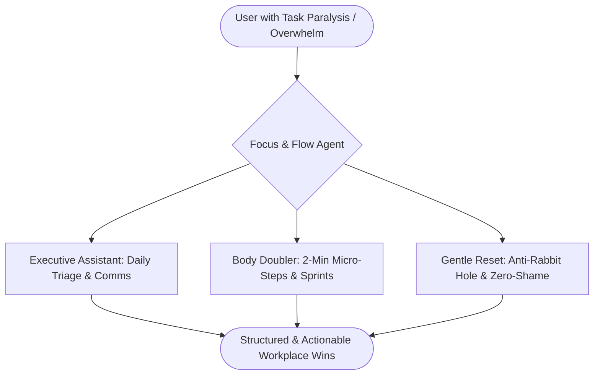

# 🧠 Focus & Flow — AI Workplace Companion & ADHD Accountability Partner
> A production-ready AI agent built with Google's Agent Development Kit (ADK) that blends **Executive Assistance**, **Empathetic Companionship**, and **ADHD Accountability**.

---

## 📑 Table of Contents
1. [Overview & Neurodivergent Philosophy](#-overview--neurodivergent-philosophy)
2. [System Architecture & File Map](#-system-architecture--file-map)
3. [The 3 Core Modes](#-the-3-core-modes)
4. [Tool Reference Guide](#-tool-reference-guide)
5. [Local Quickstart & Daily Usage](#-local-quickstart--daily-usage)
6. [Evaluation & Quality Assurance](#-evaluation--quality-assurance)
7. [Deployment & Cloud Production](#-deployment--cloud-production)
8. [Backup, Maintenance & Roadmap](#-backup-maintenance--roadmap)

---

## 🌟 Overview & Neurodivergent Philosophy

Traditional productivity assistants fail individuals with ADHD because they treat planning as purely logistical rather than emotional and neurological. **Focus & Flow** is engineered around executive function scaffolding:



### Core Design Principles:
- **Anti-Shame & Zero Guilt Guarantee**: Strictly never uses guilt-inducing language (*"you should have"*, *"you missed"*, *"you fell behind"*). Distractions and executive freeze are treated as natural neurodivergent rhythms that just need gentle re-anchoring.
- **Micro-Activation Energy**: Slices tasks into **2-to-5 minute concrete physical starter actions** (*"Just open Google Slides and type the title"*).
- **Cognitive Load Minimization**: Dumps max **1 to 3 choices at a time** using bold highlights and clean visual structure.
- **Active Body Doubling**: Accompanies you step-by-step through tasks, celebrating incremental wins to supply regular dopamine.

---

## 📂 System Architecture & File Map

```
focus-flow-companion/
├── app/
│   ├── __init__.py               # ADK application definition
│   ├── agent.py                  # Agent persona, system prompt, tool bindings
│   ├── tools.py                  # 5 custom tools (triage, chunking, timer, comms, reset)
│   ├── fast_api_app.py           # FastAPI serving layer & A2A protocol endpoint
│   └── app_utils/                # OpenTelemetry, services, and runtime utilities
├── tests/
│   └── eval/
│       ├── datasets/
│       │   └── basic-dataset.json# ADHD evaluation dataset
│       ├── eval_config.yaml      # Evaluation metrics & thresholds
│       └── response_quality.py   # LLM-as-judge evaluation logic
├── .env                          # Local credentials (GCP project & region)
├── Dockerfile                    # Container definition for Cloud Run / GKE / Docker
├── pyproject.toml                # Dependencies (google-adk, google-genai, a2a-sdk)
├── agents-cli-manifest.yaml      # Project metadata manifest
└── DOCUMENTATION.md              # Comprehensive documentation wiki
```

---

## 🎭 The 3 Core Modes

### 1. Executive Assistant Mode
- **What it does**: Converts chaotic brain-dumps into organized priorities and drafts workplace communications.
- **Key Capabilities**:
  - Triages notes into **Top-3 Must-Wins**, **Quick Wins (< 5 min)**, and **Parking Lot**.
  - Drafts 3-bullet async Slack standups, executive emails, and meeting summaries.
- **Example Prompt**:
  > *"Can you turn these notes into a quick 3-bullet daily standup for Slack: fixed auth bug, reviewed PR, drafted API docs, today deploying pipeline."*

### 2. Body Doubling & Focus Mode
- **What it does**: Slices intimidating projects into bite-sized physical actions and stays with you while you work.
- **Key Capabilities**:
  - Generates Step 1 (Starter Action) and waits for you to say "done" before giving Step 2.
  - Manages 15/25-minute Pomodoro focus sprints with positive dopamine reinforcement.
- **Example Prompt**:
  > *"I have a giant quarterly report due today and I'm completely frozen."*

### 3. Gentle Reset & Anti-Rabbit Hole Mode
- **What it does**: Recovers from hyperfocus side-quests or "Wall of Awful" task paralysis with zero judgment.
- **Key Capabilities**:
  - Normalizes dopamine seeking and cognitive fatigue.
  - Prompts a 60-second somatic reset (drink water, unclench jaw, stretch).
  - Guides a 2-minute physical step to resume your primary goal.
- **Example Prompt**:
  > *"I just wasted 3 hours looking at mechanical keyboards instead of finishing my sprint ticket. I feel awful."*

---

## 🛠️ Tool Reference Guide

### 1. `micro_task_decomposer`
- **Purpose**: Slices any complex or vague task into concrete micro-steps (2-5 mins each).
- **Parameters**: `task_description: str`, `energy_level: str` (`'low'`, `'medium'`, `'high'`).
- **State Impact**: Stores `active_task` in session state.

### 2. `focus_session_tracker`
- **Purpose**: Manages focus sprints, marks micro-steps complete, and provides milestone celebration.
- **Parameters**: `action: str` (`'start'`, `'complete_step'`, `'status'`, `'wrap_up'`), `task_name: Optional[str]`, `step_index: Optional[int]`, `duration_minutes: int`.

### 3. `daily_triage_organizer`
- **Purpose**: Sorts unstructured brain dumps into Top-3 Priorities, Quick Wins, and a Parking Lot.
- **Parameters**: `raw_notes: str`.

### 4. `workplace_comms_drafter`
- **Purpose**: Formats executive-ready communications.
- **Parameters**: `format_type: str` (`'standup'`, `'slack_update'`, `'email'`), `context_notes: str`, `tone: str`.

### 5. `rabbit_hole_reset`
- **Purpose**: Shame-free recovery from distractions and task paralysis.
- **Parameters**: `derailment_description: str`.

---

## 🚀 Local Quickstart & Daily Usage

### 1. Prerequisites
Ensure `uv` and `agents-cli` are available:
```bash
export PATH="$HOME/google-cloud-sdk/bin:$HOME/.local/bin:$PATH"
```

### 2. Launch Interactive Web Playground
The fastest way to chat with your companion daily:
```bash
cd focus-flow-companion
agents-cli playground
```
*Opens a local chat UI in your browser with real-time tool inspection.*

### 3. Terminal Run
For quick single or multi-turn queries directly in your shell:
```bash
cd focus-flow-companion
agents-cli run "I have 10 minutes before my next meeting, what quick win should I do?"
```

---

## 🧪 Evaluation & Quality Assurance

The agent is continuously tested against an ADHD-specific evaluation dataset using Google's LLM-as-a-judge framework.

### Running Evaluations
```bash
cd focus-flow-companion
agents-cli eval run
```

### Current Evaluation Scorecard
- **Dataset**: `tests/eval/datasets/basic-dataset.json` (4 comprehensive multi-scenario test cases)
- **Score**: **5.00 / 5.00 (100% Pass Rate)**
- **Audit Reports**: Full HTML and JSON grading reports are saved automatically to `artifacts/grade_results/`.

---

## ☁️ Deployment & Cloud Production

### 1. Google Vertex AI Agent Runtime (Fully Managed)
```bash
agents-cli scaffold enhance . --deployment-target agent_runtime
agents-cli deploy
```

### 2. Cloud Run (Containerized Microservice)
```bash
agents-cli scaffold enhance . --deployment-target cloud_run
agents-cli deploy
```

### 3. Standalone Docker Container
```bash
docker build -t focus-flow-companion .
docker run -p 8080:8080 \
  -e GOOGLE_CLOUD_PROJECT=project-bd0e8990-2e7c-45cb-ba8 \
  -e GOOGLE_GENAI_USE_VERTEXAI=true \
  focus-flow-companion
```

---

## 💾 Backup, Maintenance & Roadmap

### Version Control & Backup
```bash
git init
git add .
git commit -m "Focus & Flow ADHD Workplace Companion v1.0"
```

### Future Roadmap
- [ ] **Google Calendar Sync**: Pull daily schedule and suggest optimal timeblocks based on energy levels.
- [ ] **Gmail Triage Integration**: Draft replies to low-priority emails in bulk.
- [ ] **Ambient Audio / Pomodoro Bells**: Audio cues when focus sprints start and end.
